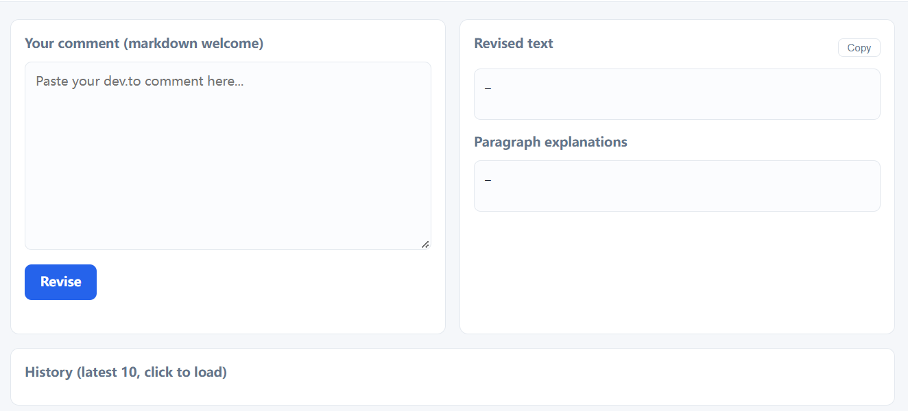

# Dev.to Comment Reviser

An AI writing assistant for dev.to comments: paste a comment, get a revised version plus paragraph-by-paragraph explanations of every change.

> **Unofficial personal project — not affiliated with dev.to.**



## Why this exists

Dev.to is a great place for developers to exchange ideas, and clear writing makes those conversations better.

As a non-native English writer, I use AI to polish my English, but I got tired of pasting the same prompt into a chat
window every time. So I built this tool, with the prompt already built in: paste a comment, click **Revise**, get the revision back. It helps me write better comments on dev.to and improve my own writing along the way.

Feel free to use it. Pull requests and issues are welcome.

## Features

- Paste any comment — markdown, inline code, and code blocks are preserved
- **Revised text** with a one-click **Copy** button, ready to post
- **Paragraph-by-paragraph explanations** of what changed and why
- **History** of the latest 10 submissions, stored locally in SQLite. Click any entry to reload it
- Interactive API docs (Swagger UI) at `/docs`

## Tech stack

Python · FastAPI · Pydantic · SQLite (`sqlite3` from the standard library) · Jinja2 · DeepSeek API (OpenAI-compatible)

## Requirements

- Python **3.10+**
- A DeepSeek API key: create one at <https://platform.deepseek.com>

## Setup

```bash
# 1. Install dependencies
python -m pip install -r requirements.txt     # macOS / Linux
py -m pip install -r requirements.txt         # Windows (py launcher)

# 2. Create your .env from the template
cp .env.example .env                          # macOS / Linux
copy .env.example .env                        # Windows
```

Then open `.env` and replace `your_deepseek_api_key_here` with your real key.

> `DS_MODEL` and `DS_BASE_URL` in `.env` are optional overrides; the defaults already point at DeepSeek.

## Run

```bash
python -m uvicorn main:app --reload           # macOS / Linux
py -m uvicorn main:app --reload               # Windows
```

- Web UI: <http://127.0.0.1:8000>
- API docs (Swagger): <http://127.0.0.1:8000/docs>

## Tests — no AI calls, no cost

The AI call is mocked, so the suite runs offline and never spends money:

```bash
python -m pytest tests -q                     # macOS / Linux
py -m pytest tests -q                         # Windows
```

## API quick reference

| Method | Path | Purpose |
|---|---|---|
| GET | `/` | web UI |
| POST | `/feedback` | body `{"text": "..."}` → `{"id", "revised", "explanations"}` |
| GET | `/history?limit=10` | recent submissions |
| GET | `/history/{id}` | one submission |

## Project structure

```
main.py               FastAPI app: web page + POST /feedback + GET /history
llm.py                DeepSeek call (OpenAI-compatible SDK) + reply parsing
db.py                 SQLite via stdlib sqlite3 (hand-written SQL)
prompts.py            the system prompt (source of truth)
templates/index.html  the web UI
tests/test_api.py     API tests; the AI call is mocked (zero cost)
assets/               screenshots used in this README
```

## Notes

- `.env` holds your API key — **never commit it**. It is already listed in `.gitignore`; use `.env.example` as the template.

- `history.db` is created automatically on first start and is also gitignored. Your submissions stay on your machine.

- Status: MVP.

  Planned next: delete and edit history entries, response models, richer prompt options.

## License

MIT — see `LICENSE`.
